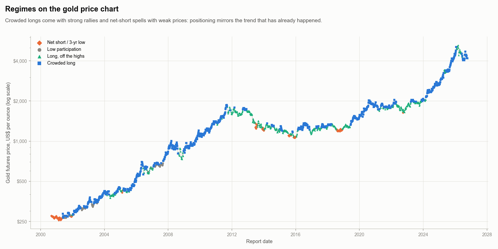
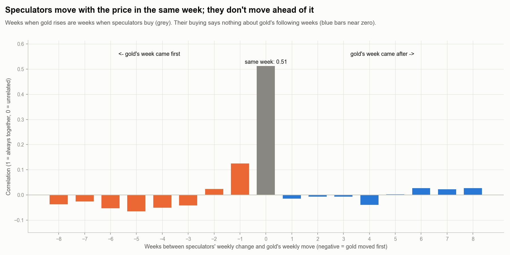
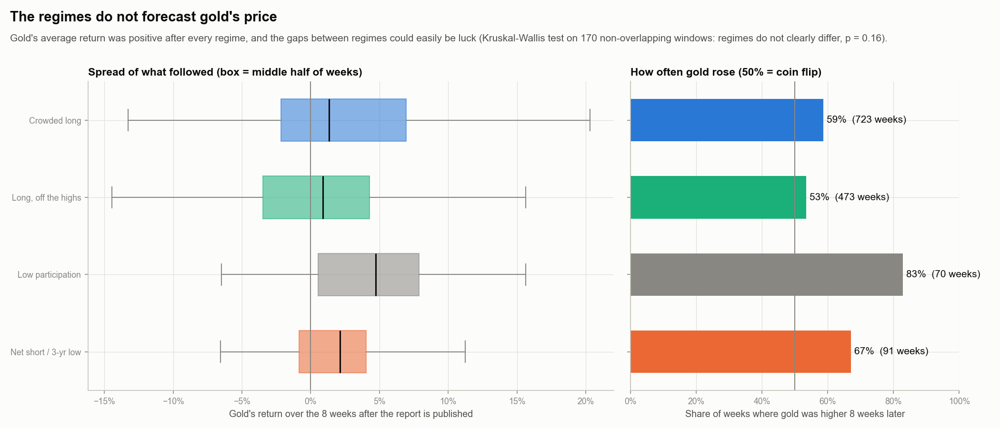
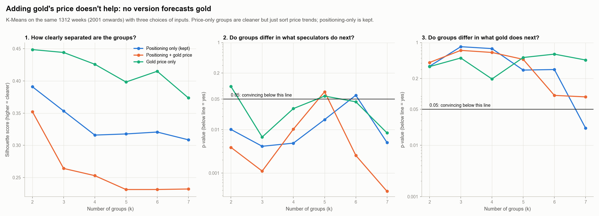
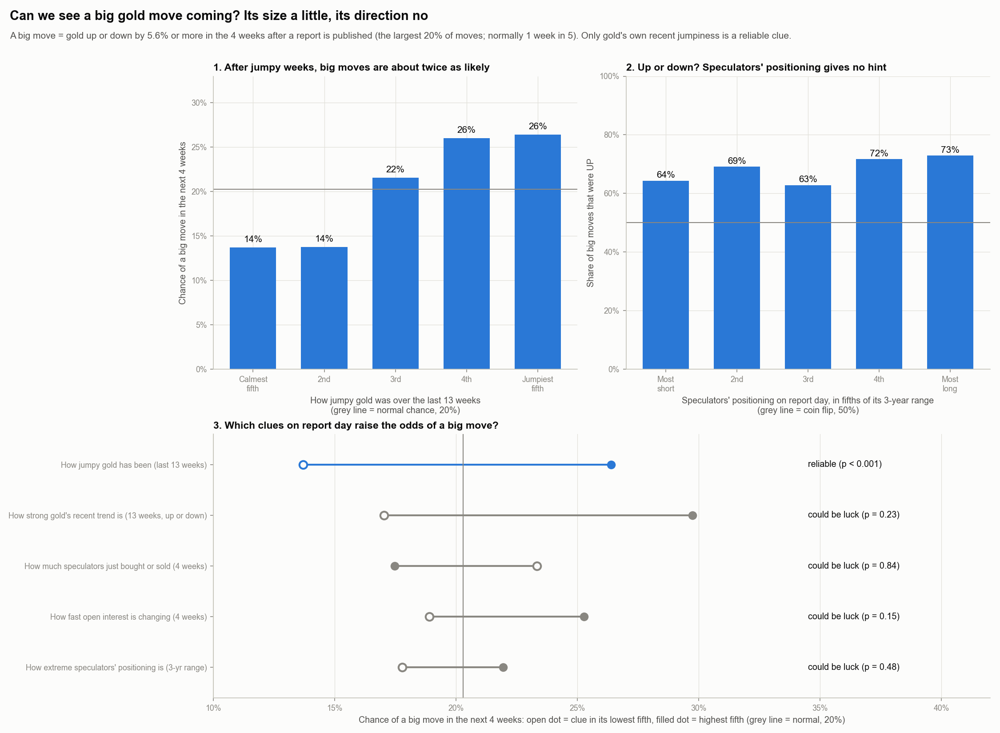

# Gold positioning regimes

_Generated by `scripts/gold_regimes.py` from 1887 weekly COT reports
(1988-02-29 to 2026-10-13), COMEX gold only._

## In one sentence

The COT report clearly shows what the big gold speculators are doing, and that they tend to pull back from
extreme bets, but it can't tell you where gold's price is heading or when a big move is coming. The best early
warning of a big move is simply that gold has recently been jumpy.

## In short

- Large speculators in gold move between **4 positioning regimes**, found by K-Means clustering
  without being told what to look for.
- The regime **tells you what speculators tend to do next**: crowded longs tend to be trimmed and net-short
  positions tend to be bought back (p-value less than 0.001).
- **They do not forecast gold's price.** Gold's return after each regime differed by no more than luck could explain (p-value 0.16): speculators move *with* the price rather than ahead of it. Adding price data to the clustering made the groups blurrier, so the positioning-only regimes are kept.
- **Big moves:** a big move (up or down) is about twice as likely after gold has been jumpy, but nothing in the COT report warns of one or says which way it will go.
- Latest report (2026-10-13): **Long, off the highs**.

These are descriptions of past positioning, not trading recommendations.

## Words used in this report

**The data**
- **COT report**: a weekly report from the US regulator (CFTC) showing how many gold futures contracts
  different groups of traders hold. Here we follow the **large speculators** (funds and big traders betting on
  the price, called "non-commercials" in the report).
- **Long / short**: a long position profits if gold rises, a short position profits if it falls.
  **Net position** = longs minus shorts.
- **Open interest**: the total number of open contracts, a measure of how big the market is.
- **3-year percentile**: where this week's net position sits compared with the last 3 years (0% = the most
  short it has been, 100% = the most long).

**The method**
- **Unsupervised learning**: the computer is given the data but *no right answers*, and is asked to find
  structure by itself, here groups of weeks that look alike. (Supervised learning would instead be told what to
  predict, such as tomorrow's price.)
- **Clustering**: sorting things into groups so that members of a group are similar and different groups are
  not, like sorting a pile of photos into piles without being told what the piles should be.
- **Regime**: our name for one of these groups of weeks; a recurring "state" the market is in.
- **K-Means**: picks *k* centre points and puts every week with its nearest centre, then moves each centre to
  the middle of its group, and repeats until nothing changes. Simple, fast, and every group has a clear
  "average week".
- **Gaussian mixture**: like K-Means, but each group is a soft oval cloud and every week gets a probability of
  belonging to each group. More flexible, but needs more data and can over-split.
- **Hierarchical clustering (Ward)**: starts with every week on its own and keeps merging the two most similar
  groups, building a family tree; we cut the tree at *k* groups.
- **DBSCAN**: looks for crowded areas separated by empty space (like spotting towns on a map at night).
  Good when groups are islands; if the data is one continuous cloud it finds a single blob.
- **PCA (principal component analysis)**: not a clustering method. It squeezes many columns into a few that
  keep most of the variation, mainly to draw the data in 2-D. We plot real columns (long share vs short share)
  instead, because they are easier to read.

**How we judge the groups**
- **Silhouette score** (from -1 to 1): for each week, is it much closer to its own group than to the next
  group? Near 1 = clearly in its group, 0 = on the border, below 0 = probably in the wrong group.
- **Davies-Bouldin score**: how much the groups overlap. Lower is better.
- **Stability (adjusted Rand index)**: we refit the model on random 80% slices of history and check whether
  the same weeks end up together. 1 = identical groups every time, 0 = no better than chance.
- **BIC**: a score for the Gaussian mixture that rewards fitting the data but penalises extra groups. Lower is
  better; if it keeps falling as groups are added, the method never settles on a natural number.

**How we judge the results**
- **Kruskal-Wallis test**: checks whether several groups really differ (for example in what gold did next) or
  whether the differences could easily be luck. It compares rankings, so a few extreme weeks can't dominate.
- **p-value**: roughly, how likely differences this big would be if there were really no difference.
  Small (below 0.05, i.e. 5%) = probably a real difference; large = could easily be luck.
- **Big move**: gold rising or falling by more than a set size (here the largest 20% of 4-week moves) in the
  weeks after a report is published, whichever the direction.
- **Volatility ("jumpiness")**: how much gold's weekly price changes have been swinging recently; a calm market
  has small weekly changes, a jumpy one large ones.
- **Correlation**: how closely two things move together, from -1 (always opposite) through 0 (unrelated) to 1
  (always together).

## The regimes

| Regime | Share of weeks | Typical stay | Net position (share of OI) | Avg. net change next 8 wks | Speculators added afterwards | Seen |
|---|---|---|---|---|---|---|
| Net short / 3-yr low | 17% | 8 weeks | -19% | +9.6% | 73% | 1988-2022 |
| Low participation | 17% | 6 weeks | +4% | -1.8% | 44% | 1988-2007 |
| Long, off the highs | 25% | 7 weeks | +27% | +3.7% | 59% | 2001-2026 |
| Crowded long | 41% | 10 weeks | +40% | -3.4% | 39% | 1991-2026 |

## Gold price: do the regimes tell us where gold goes next?

Daily COMEX gold futures prices (`GC=F` from Yahoo Finance, 2000 onwards)
were matched to each report. Gold's "next 8 weeks" are measured from the first close **after the
report is published** (Friday afternoon), so nothing is used before it was public.

**Short answer: no.** Gold's average return over the next 8 weeks was
+1.8% overall and was positive after every regime; the differences
between regimes are small and could easily be luck (Kruskal-Wallis p-value 0.16).

| Regime | Gold's avg. return next 8 wks | Gold rose afterwards | Weeks with a price |
|---|---|---|---|
| Net short / 3-yr low | +2.6% | 67% | 91 |
| Low participation | +4.5% | 83% | 70 |
| Long, off the highs | +0.6% | 53% | 473 |
| Crowded long | +2.3% | 59% | 723 |

**Why: speculators move with the price, not ahead of it.** In weeks when gold rises, speculators buy, and in
weeks when it falls they sell (correlation 0.51 in the same week). But their buying or selling says
almost nothing about gold's *next* week (-0.01) or any of the following 8 weeks (all
within ±0.04). Positioning mirrors the trend that has already happened; it is not a forecast.

**Re-running the clustering with price data.** We added gold's 3-year price percentile and its last-13-week
return to the inputs and re-ran K-Means on the same weeks. The groups became *less* clearly separated, and
still did not forecast gold. Price and positioning largely carry the same information (they move together), so
we keep the positioning-only regimes and use the price as the yardstick instead.

| Inputs | Separation (silhouette) | Stability | p-value: speculators next | p-value: gold next |
|---|---|---|---|---|
| Positioning only (kept) | 0.32 | 0.98 | 0.005 | 0.76 |
| Positioning + gold price | 0.25 | 0.9 | 0.010 | 0.64 |
| Gold price only | 0.43 | 0.92 | 0.030 | 0.20 |

## Can we see a big price move coming?

A **big move** here is gold rising or falling by **5.6% or more** in the
4 weeks after a report is published: the largest 20% of moves, which normally happen
about **1 week in 5** (20%). We split each clue known on report day into fifths and compare
how often a big move followed. Reliability is tested on weeks whose 4-week windows don't overlap.

**Will there be a big move (up or down)? Partly, but the clue is the price, not the COT report.**

| Clue on report day | Chance of a big move: lowest fifth | Chance of a big move: highest fifth | Reliable? |
|---|---|---|---|
| How jumpy gold has been (last 13 weeks) | 14% | 26% | yes (p < 0.001) |
| How strong gold's recent trend is (13 weeks, up or down) | 17% | 30% | no, could be luck (p = 0.23) |
| How much speculators just bought or sold (4 weeks) | 23% | 17% | no, could be luck (p = 0.84) |
| How fast open interest is changing (4 weeks) | 19% | 25% | no, could be luck (p = 0.15) |
| How extreme speculators' positioning is (3-yr range) | 18% | 22% | no, could be luck (p = 0.48) |

- After gold's **jumpiest** 13 weeks, a big move followed 26% of the time,
  against 14% after its **calmest**: roughly twice as likely. Big moves come
  in bunches ("volatility clustering"), a well-known pattern in markets. Even so, most jumpy weeks were **not**
  followed by a big move, so this raises the odds rather than giving a warning.
- None of the COT clues (how much speculators just bought or sold, open interest changes, extreme positioning)
  changed the odds by more than luck could explain.

**Will it be a buy or a dump? No hint.** Of the 273 big moves, 68% were up,
mostly because gold rose for most of 2000-2026. Speculators' positioning, their recent buying or selling and
gold's recent trend did not point to the direction (all correlations within ±0.07).

## Why K-Means with 4 regimes

Positions are measured as a share of open interest because the market is about 3x its 1986 size
(peaking at 5x), so raw contract counts mostly measure market size.
Only the slow-moving "where speculators stand" features are used (long share, short share and the 3-year
percentile of the net position). Adding the noisy 4-week flows made every model's groups blurrier.

- **DBSCAN** puts nearly all weeks in one blob: positioning is one continuous cloud, not separate islands.
- **Gaussian mixture** improves its fit with every extra group (BIC never bottoms out), so it gives no natural
  count, and its groups are less clearly separated.
- **Hierarchical (Ward)** groups change a lot when part of the history is left out.
- **K-Means** separates the groups most clearly at every group count, and refitting it on random 80% slices
  of history gives almost the same groups (agreement 0.96 out of 1, level with the
  Gaussian mixture), with regimes lasting 8 weeks on average.
  With 2 groups separation is slightly higher, but that only splits "long-heavy" from "not".

| Model | Separation (silhouette, higher better) | Overlap (Davies-Bouldin, lower better) | Repeatability (1 = identical) | Avg. weeks per regime |
|---|---|---|---|---|
| K-Means | 0.37 | 0.93 | 0.96 | 7.83 |
| Gaussian mixture | 0.32 | 1.17 | 0.97 | 13.48 |
| Hierarchical (Ward) | 0.36 | 0.94 | 0.66 | 11.1 |

## Figures

**Why we use shares of the market instead of raw contract counts.**

**The evidence for K-Means with 4 regimes (each panel answers one question).**

**Every week placed by speculators' longs and shorts, coloured by regime.**

**The average week in each regime.**

**Which regime each week was in, over 38 years.**

**What speculators did over the 8 weeks after each regime.**

**How likely each regime is to switch to another the following week.**

**How clearly each week belongs to its regime.**

**The regimes drawn on the gold price chart.**

**Do speculators move before, with or after the price?**

**What gold did over the 8 weeks after each regime was published.**

**Re-running the clustering with gold price features added.**

**Can a big gold move be seen coming on report day?**

## Caveats

- The model is fitted on the full history, so it describes the past; it is not a forecast tested out-of-sample.
- The "Low participation" regime is mostly the 1988-2007 era, when speculators held a smaller share of the
  market; it partly reflects a different market structure rather than a state that recurs today.
- Tests use one week in every 8 so their windows don't overlap
  (235 weeks tested for positioning).
- Gold prices are the continuous front-month futures contract, which switches to the next contract each
  delivery month; for gold these switches are small.

## Further reading

Beginner-friendly first.

1. StatQuest with Josh Starmer (YouTube, short visual explainers). Search for "StatQuest K-means",
   "StatQuest PCA", "StatQuest DBSCAN" and "StatQuest p-values": https://www.youtube.com/@statquest
2. James, Witten, Hastie & Tibshirani, *An Introduction to Statistical Learning* (2nd ed., free PDF),
   chapter 12 "Unsupervised Learning": https://www.statlearning.com
3. scikit-learn user guide, "Clustering" (pictures of every method on example data):
   https://scikit-learn.org/stable/modules/clustering.html
4. scikit-learn example, "Selecting the number of clusters with silhouette analysis":
   https://scikit-learn.org/stable/auto_examples/cluster/plot_kmeans_silhouette_analysis.html
5. CFTC, "Commitments of Traders: explanatory notes":
   https://www.cftc.gov/MarketReports/CommitmentsofTraders/ExplanatoryNotes/index.htm
6. Briese, S. (2008). *The Commitments of Traders Bible*. Wiley. (How traders use COT data, including the
   3-year "COT index".)
7. Wang, C. (2003). The behavior and performance of major types of futures traders. *Journal of Futures
   Markets*, 23(1), 1-31.

Original papers behind the methods:

8. Lloyd, S. (1982). Least squares quantization in PCM. *IEEE Transactions on Information Theory*, 28(2),
   129-137. (K-Means)
9. Ester, M., Kriegel, H.-P., Sander, J. & Xu, X. (1996). A density-based algorithm for discovering clusters in
   large spatial databases with noise. *Proceedings of KDD-96*, 226-231. (DBSCAN)
10. Rousseeuw, P. J. (1987). Silhouettes: a graphical aid to the interpretation and validation of cluster
    analysis. *Journal of Computational and Applied Mathematics*, 20, 53-65.
11. Hubert, L. & Arabie, P. (1985). Comparing partitions. *Journal of Classification*, 2, 193-218.
    (Adjusted Rand index)
12. Schwarz, G. (1978). Estimating the dimension of a model. *Annals of Statistics*, 6(2), 461-464. (BIC)
13. Kruskal, W. H. & Wallis, W. A. (1952). Use of ranks in one-criterion variance analysis. *Journal of the
    American Statistical Association*, 47(260), 583-621.
