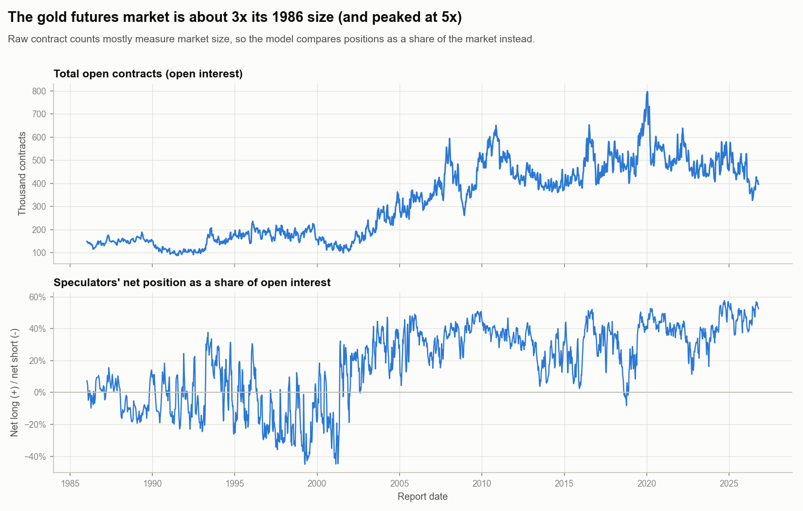
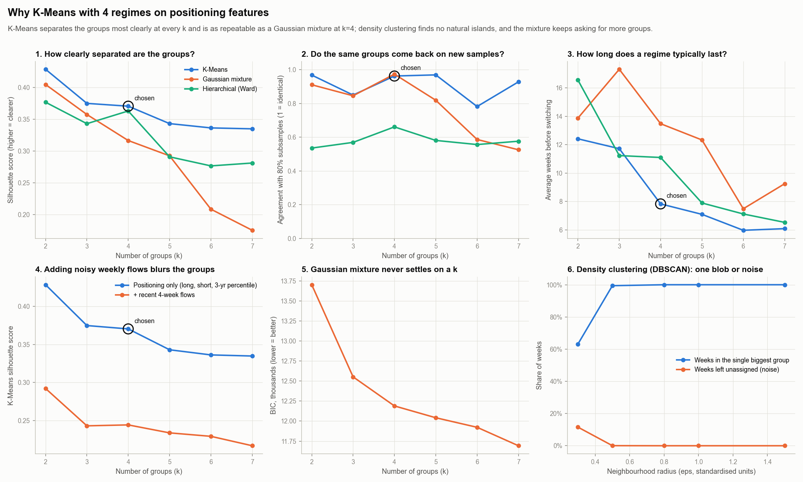
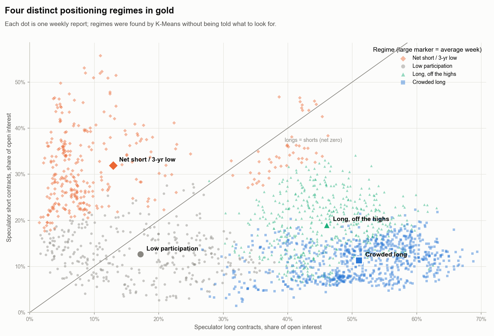
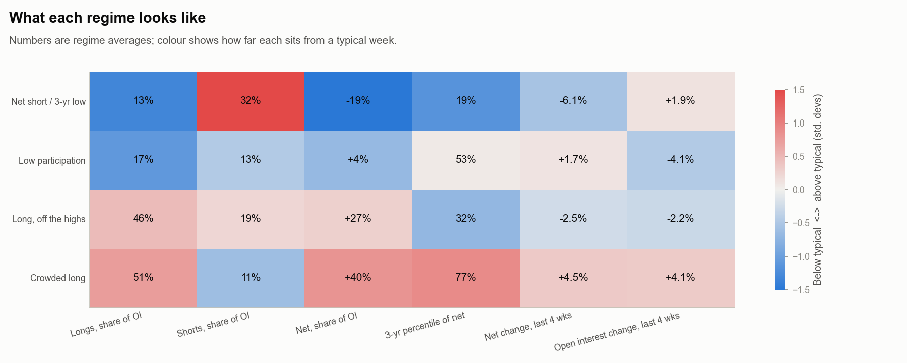
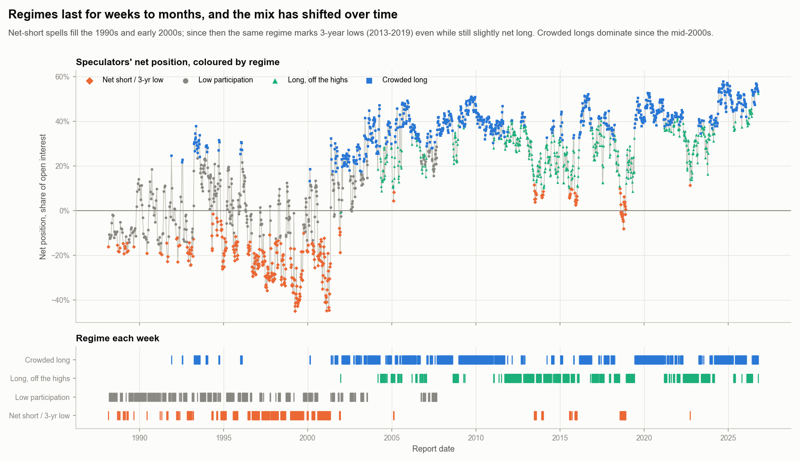
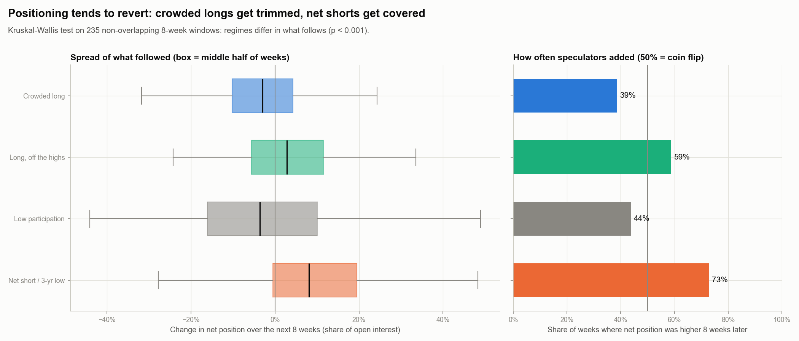
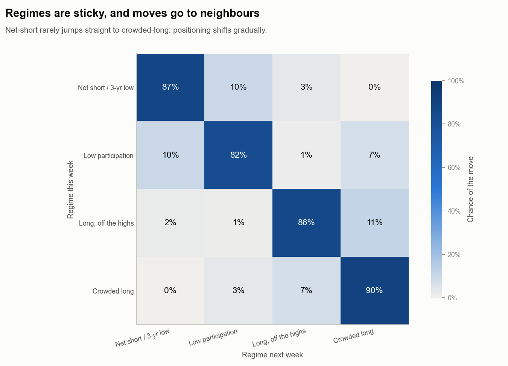
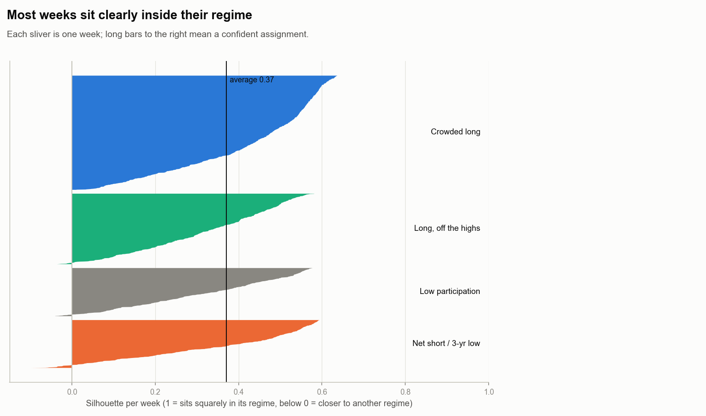

# Gold positioning regimes

_Generated by `scripts/gold_regimes.py` from 1887 weekly COT reports
(1988-02-29 to 2026-10-13), COMEX gold only._

## In short

- Large speculators in gold move between **4 positioning regimes**, found by K-Means clustering
  without being told what to look for.
- The regime **tells you something about what speculators do next**: crowded longs tend to be trimmed and
  net-short positions tend to be covered by buying back (statistical test p-value less than 0.001).
- Latest report (2026-10-13): **Long, off the highs**.

These are descriptions of past positioning, not trading recommendations.

## The regimes

| Regime | Share of weeks | Typical stay | Net position (share of OI) | Avg. net change next 8 wks | Speculators added afterwards | Seen |
|---|---|---|---|---|---|---|
| Net short / 3-yr low | 17% | 8 weeks | -19% | +9.6% | 73% | 1988-2022 |
| Low participation | 17% | 6 weeks | +4% | -1.8% | 44% | 1988-2007 |
| Long, off the highs | 25% | 7 weeks | +27% | +3.7% | 59% | 2001-2026 |
| Crowded long | 41% | 10 weeks | +40% | -3.4% | 39% | 1991-2026 |

## Why K-Means with 4 regimes

Positions are measured as a share of open interest because the market is about 3x its 1986 size
(peaking at 5x), so raw contract counts mostly measure market size.
Only the slow-moving "where speculators stand" features are used (long share, short share and the 3-year
percentile of the net position). Adding the noisy 4-week flows made every model's groups blurrier.

- **DBSCAN** (density) puts nearly all weeks in one blob or calls them noise: there are no isolated islands.
- **Gaussian mixture** improves its fit with every extra group (BIC never bottoms out), so it gives no natural
  count, and its groups are less clearly separated.
- **Hierarchical (Ward)** groups change a lot when part of the history is left out.
- **K-Means** separates the groups most clearly at every group count, and refitting it on random 80% slices
  of history gives almost the same groups (agreement 0.96 out of 1, level with the
  Gaussian mixture), with regimes lasting 8 weeks on average.
  With 2 groups separation is slightly higher, but that only splits "long-heavy" from "not".

| Model | Separation (silhouette, higher better) | Overlap (Davies-Bouldin, lower better) | Repeatability (1 = identical) | Avg. weeks per regime |
|---|---|---|---|---|
| K-Means | 0.37 | 0.93 | 0.96 | 7.83 |
| Gaussian mixture | 0.32 | 1.17 | 0.97 | 13.48 |
| Hierarchical (Ward) | 0.36 | 0.94 | 0.66 | 11.1 |

## Figures

## Caveats

- The model is fitted on the full history, so it describes the past; it is not a forecast tested out-of-sample.
- The "Low participation" regime is mostly the 1988-2007 era, when speculators held a smaller share of the
  market; it partly reflects a different market structure rather than a state that recurs today.
- The test uses one week in every 8 so its windows don't overlap
  (235 weeks tested).
